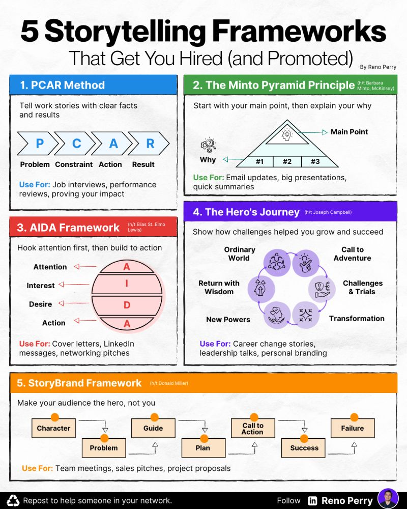

# Promotion

Promotion here is an umbrella term for all the activities you undertake to
communicate the value of the product, your professional persona.

The goal of the promotion is to project a cohesive image, easily digestible by
the target audience.

## Elevator Pitch

Your [elevator pitch](https://en.wikipedia.org/wiki/Elevator_pitch) answers the
question "Who are you?".

You should:

- be able to spit it out without thinking much;
- adjust it according to the audience;
- deliver the answer in an engaging manner.

Ideal outcome: "Tell me more." Be ready to do that too.

## Resume

Your [resume](https://capd.mit.edu/resources/resumes/) is a marketing document,
not a [Curriculum Vitae](https://en.wikipedia.org/wiki/Curriculum_vitae).
For every line, ask: does this help the employer see why they should hire me?

- Length: 1 page for anybody with \<2 years of experience, \<=2 pages otherwise;
- Tailor it to the role: emphasize relevant skills and accomplishments.
- Show what you achieved, with numbers when useful.
- Use technical terms your audience understands.
- For U.S. applications: no birth date, no dates for degrees/education (unless
  you are still in school), no marital status, no photos.

## LinkedIn

My take - you need to be:

- present on LinkedIn;
- be a member in the relevant LinkedIn groups;
- have posts and, ideally, LinkedIn articles;
- make some (insightful) comments to the posts of the others.
- [more tips](https://www.linkedin.com/posts/vanessavanedwards_linkedin-has-brought-me-career-opportunities-activity-7421937545036607489-WXle?utm_source=share&utm_medium=member_desktop&rcm=ACoAAAAAmHEBxaJci6u_zxUz5Tv1t5FjezGKpf4)

## GitHub

Again, my take here. If you are an engineering type (no matter which) or work for a high-tech company, you need to be:

- present on GitHub;
- have repos. Cloning repos alone is not enough;
- have a GitHub Pages site.

For software engineers, you also need:

- have issues submitted into the repos you do not own;
- have some PRs merged into the repos you do not own.

## Stories You Tell

Prepare examples for [interview questions](interview-questions.md). Choose a
structure that suits the message:

- [STAR](https://en.wikipedia.org/wiki/Situation,_task,_action,_result): situation, task, action, result. Use problem, action, result for a shorter account; include relevant constraints. See [MIT's interview worksheet](https://capd.mit.edu/resources/the-star-method-for-behavioral-interviews/).
- [Minto Pyramid](https://www.barbaraminto.com/): lead with the conclusion, then group the supporting arguments. See [a worked example](https://untools.co/minto-pyramid/).
- [AIDA](<https://en.wikipedia.org/wiki/AIDA_(marketing)>): attention, interest, desire, action. Give your pitch a clear next step.
- [Hero's Journey](https://en.wikipedia.org/wiki/Hero%27s_journey): challenge and transformation; useful for longer career stories.
- [StoryBrand](https://storybrand.com/): make the customer the hero and the business the guide. Adapt your pitch around the employer's problem. See [the framework explained](https://www.creativeo.co/post/storybrand-framework).

Illustrated summary shared by [Reno Perry](https://www.linkedin.com/in/renoperry/):

